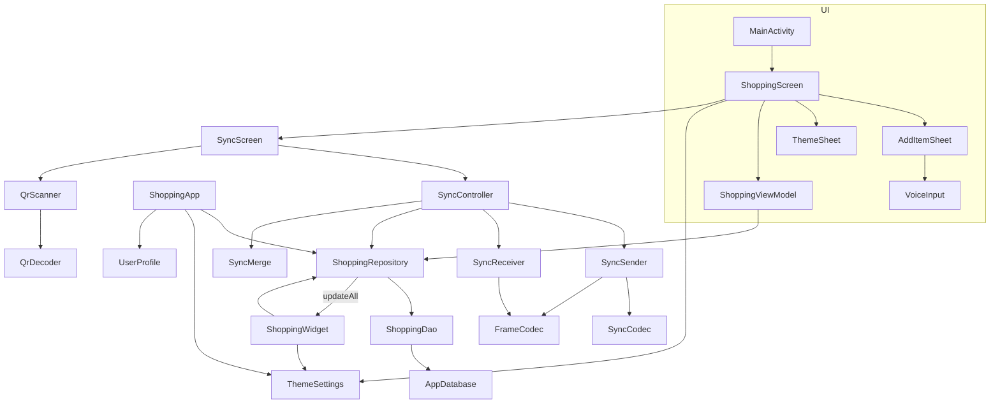

# Список покупок (Android)

Приложение-список покупок: Kotlin, Jetpack Compose (Material3), Room, виджет на Glance. Один модуль `:app`,
пакет `com.mok.buylist`, minSdk 29, targetSdk 37. Интерфейс и комментарии в коде — на русском; пользователь пишет по-русски.

**Читай этот файл вместо повторного обхода проекта.** Меняешь архитектуру или добавляешь файл — обнови карту ниже.

## Сборка и проверка

- **Правило проекта:** не запускать сборку после каждой отдельной правки. Проверять и собирать релиз по завершении этапа или когда это необходимо для диагностики: `:app:assembleRelease` (при подготовке
  артефактов также `:app:bundleRelease`). `assembleDebug` запускать только по явному запросу пользователя или когда
  конкретная диагностическая задача технически требует debug-вариант. В результате пользователю отдавать
  `app/build/outputs/apk/release/app-release.apk`, а не debug APK.
- APK не устанавливать и не запускать для проверки после каждого изменения: пользователь отдельно скажет, когда нужна проверка приложения на устройстве или эмуляторе.
- Gradle требует **JDK 25** (`gradle/gradle-daemon-jvm.properties`). Из терминала с обычным `JAVA_HOME` сборка падает на
  скачивании JDK. Работает так (PowerShell):
  `$env:JAVA_HOME="C:\Program Files\Android\Android Studio\jbr"; .\gradlew.bat :app:assembleDebug :app:testDebugUnitTest "-Dorg.gradle.java.home=C:\Program Files\Android\Android Studio\jbr"`
- **Релиз**: `.\gradlew.bat :app:assembleRelease :app:bundleRelease` (те же `JAVA_HOME` и `-Dorg.gradle.java.home`). Результат:
  `app/build/outputs/apk/release/app-release.apk` (~4,1 МБ) и `app/build/outputs/bundle/release/app-release.aab`. Включены R8 (`optimization`),
  сжатие ресурсов, только локали ru/en, исключены служебные файлы библиотек (`packaging.resources.excludes`). С синхронизацией (CameraX + ZXing core)
  APK ~4,8 МБ. Шрифт `manrope.ttf` урезан до
  латиницы и кириллицы (переменная ось wght сохранена; пересборка: `python -m fontTools.subset`). Правила R8 для рефлексии — `app/proguard-rules.pro` (WorkManager/Glance: без них виджет вечно крутит загрузку; `packageScope` в `optimization` не ставить — приложение падает при запуске). **Подпись пока отладочным ключом** — для Google Play
  нужен свой ключ (`signingConfigs`), без него загрузить `.aab` нельзя. `gradlew clean` падает, пока Android Studio держит `app/build`.
- JVM-тесты находятся в `app/src/test`. Тестов на Compose нет.
  Инструментальные тесты — только `SyncRepositoryTest` (два репозитория на двух базах Room в памяти; идут в процессе приложения, но свою
  БД `shopping.db` не трогают). Ещё `connectedDebugAndroidTest` по умолчанию удаляет приложение с эмулятора после прогона.
- **Эмулятор есть**: AVD `Medium_Phone` (x86_64, Android 16, без аппаратного ускорения — медленный, иногда «System UI isn't responding», это не баг приложения).
  После проверок обязательно останавливать эмулятор, запущенный агентом; уже работавший пользовательский эмулятор не останавливать.
  Запуск без окна: `emulator.exe -avd Medium_Phone -no-window -no-audio -no-snapshot -gpu swiftshader_indirect` (SDK: `%LOCALAPPDATA%\Android\Sdk`),
  дальше `adb install -r`, `adb logcat -b crash`, `adb exec-out screencap -p`. Виджет добавляется через долгое нажатие на рабочем столе → Widgets → Browse → «Список покупок» → Add.
  Телефона нет. Релизную сборку проверять на эмуляторе только по запросу пользователя: R8 может ломать запуск и виджет, а юнит-тесты этого не ловят.
  Кириллицу `adb input text` не вводит — для проверок пишем латиницей.

## Карта

| Файл | Что делает |
|---|---|
| `ShoppingApp.kt` | `Application`: синглтоны репозитория, каталога «Ленты», профиля и темы |
| `data/Entities.kt` | Room-сущности списка, каталога, архива, удалений и пользователей |
| `data/ShoppingTotals.kt` | Точный расчёт стоимости в копейках, безопасное сопоставление и переходный снимок события покупки (этап 01) |
| `ui/ProductHistoryScreen.kt` | История товаров и общий экран событий по ID: интервалы, цены по типам и отдельные покупки (этап 10) |
| `ui/ItemDetailsSheet.kt` | Сведения о позиции после удержания карточки: локальные данные и асинхронное обновление из «Ленты» (этап 03) |
| `ui/ProductsScreen.kt` | Каталог продуктов: поиск, добавление и удаление продуктов |
| `data/AppDatabase.kt` | Room v17, миграции 1→17 и схемы в `app/schemas/`; вес в граммах хранится у позиции, архив хранит отдельный снимок некупленных позиций |
| `data/UserProfile.kt` | Профиль (id + имя) в SharedPreferences `profile`; id создаётся при первой регистрации и не меняется. `StateFlow<Profile?>`: `null` = первый запуск |
| `ui/ProfileDialog.kt` | Диалог имени: при первом запуске закрыть нельзя (`required`), позже — смена имени из экрана синхронизации |
| `sync/*` | **Чистый Kotlin без Android** (кроме QR-кодирования через ZXing): `SyncModel` (снимок состояния), `SyncCodec` (двоичный формат + deflate), `SyncMerge` (слияние, `helloOf`/`forPeer`), `SyncFrames` (`Frame`, Base45-кадры, `Assembler`), `SyncTransfer` (`SyncSender` показ, `SyncReceiver` приём), `QrEncoder`/`QrDecoder`, `Base45` |
| `ui/SyncScreen.kt`, `ui/SyncController.kt`, `ui/QrScanner.kt` | Настройки синхронизации поблизости, копии в файл и отката; камера также используется для первого подключения и штрихкодов. Старая передача данных через последовательность QR и автоматическое создание локальных копий отключены. |
| `ui/BarcodeScannerSheet.kt`, `sync/ProductBarcodeDecoder.kt` | Шторка камеры и распознавание товарных EAN/UPC; поиск товара и отметка покупки по сохранённому штрихкоду |
| `sync/Backup.kt` | `BackupCodec` / `BackupContents`: формат файла резервной копии (владелец + снимок) |
| `ui/ArchiveBuyers.kt` | `listBuyers` (кто купил список: один / несколько / неизвестно) |
| `ui/UserStats.kt` | `filterByUser` / `buyersIn`: статистика по человеку (чипы «Все / имя» в `StatsScreen`, если покупали несколько человек) |
| `data/TripTime.kt` | Таймер похода: `computeTripTime` делит отметки «куплено» на заходы по паузе > 30 мин (`VISIT_GAP_MILLIS`) и суммирует их длительности; `tripMinutes` |
| `data/ShoppingDao.kt` | Запросы списка, каталога, архива, пользователей и удалений |
| `data/ShoppingRepository.kt` | Вся логика товаров: `add`, `buy`, `remove`, `restore`, счётчики; после изменений обновляет виджет |
| `ui/MainActivity.kt` | Edge-to-edge, тема приложения из `ThemeSettings`, цвет значков системных панелей |
| `ui/ShoppingScreen.kt` | Экран: шапка с прогрессом и переключателем темы, список, свайп-удаление, кнопка «+», пустое состояние |
| `ui/ShoppingViewModel.kt` | `rows` (список + только что купленные/удалённые), `progress`, добавление по ID, покупка и отмена |
| `ui/ArchiveScreen.kt`, `ui/ArchiveFormat.kt` | Архив: компактные строки с выбором, повтор, удаление и шторка с историческим снимком покупки; форматирование даты («Сегодня, 19:42») |
| `ui/StatsScreen.kt`, `ui/Stats.kt` | Статистика по архиву (кнопка в шапке архива): числа, самые частые товары, списки по неделям и месяцам, любимый день; расчёты покрыты `StatsTest` |
| `ui/ExpenseStats.kt`, `ui/ExpenseStatsPanel.kt` | Расчёт расходов по снимкам событий и интерфейс периодов, частоты, цен и распределения; учитывается текущий поход |
| `ui/LentaSearchController.kt` | Local-first поиск, отмена запросов и постраничная загрузка «Ленты» |
| `ui/ProductHistoryScreen.kt` | История купленных товаров из статистики: поиск, последняя дата в общем списке, даты покупок и средний интервал; общий архив и покупки из текущего списка |
| `ui/AddItemSheet.kt` | Шторка поиска «Ленты» с голосовым вводом и выбором карточки |
| `data/LentaCatalog.kt`, `ui/LentaUi.kt` | Поиск MCP «Ленты» по адресу в канале `locc`; карточки и цены в Room, адрес в настройках. Каталог передаётся через QR и резервные копии, изображения — по URL |
| `ui/VoiceInput.kt` | `SpeechRecognizer`: уровни звука для волны, промежуточный и итоговый (до 5 вариантов) результат, разрешение на микрофон |
| `ui/ThemeSheet.kt` | Шторка «Тема оформления»: Авто/Светлая/Тёмная отдельно для приложения и виджета |
| `ui/theme/Type.kt` | Шрифт Manrope (переменный TTF, оси wght 400–800) и `ShoppingTypography` |
| `ui/theme/Theme.kt` | `ShoppingPalette` (Light/Dark), `ThemeMode`, `ShoppingTheme`, `LocalPalette` |
| `ui/theme/Motion.kt` | Единые параметры анимаций: длительности `Quick/Medium/Slow`, кривая `Smooth`, `settle()` для сдвигов списка. Анимаций мало и они короткие — новые добавлять только по делу |
| `ui/theme/ThemeSettings.kt` | Выбор темы в SharedPreferences, два `StateFlow` (app, widget) |
| `widget/ShoppingWidget.kt` | Виджет Glance: список, счётчик-кружок, пустое состояние; `BuyItemAction` |
| `res/drawable/ic_*.xml` | Иконки-штрихи (белые, красятся `tint`); лаунчер-иконка в `ic_launcher_*` |

## Правила данных (важно не сломать)

- `items.deleted = 1` значит **куплено**: строка остаётся для прогресса «N из M». Свайп-удаление (`remove`) — **полное** стирание
  строки (с «надгробием» для обмена), в прогресс не входит.
- **Завершение списка и архив**: когда непокупленного не осталось, купленное переносится в `archived_lists` (дата = время последней покупки)
  и стирается из `items` — прогресс обнуляется (`ShoppingRepository.finishTripIfDone` / `archiveFinishedTrip`). Вызывается: из VM, когда
  закрылось окно «Отменить»; при старте VM (приложение могли закрыть раньше); из `add()` перед вставкой; из виджета после покупки.
  Пока на экране есть строки с «Отменить» или товары, прогресс показывается; иначе скрыт (`ShoppingViewModel.progress` даёт total = 0).
- **Таймер похода**: считается один раз при завершении списка (`archiveFinishedTrip`) по `updatedAt` купленных товаров. Заход = серия отметок
  с паузами ≤ 30 мин; длительность захода = от первой до последней отметки; итог = сумма заходов (поход «магазин утром, магазин вечером» не
  превращается в «8 часов»). Заход из одной покупки = 0 мин. У записей до v4 время 0 = неизвестно, в среднее не входит. Время в магазин
  «до первой отметки» приложению не видно, поэтому оно слегка занижено.
- **Удаление продукта из базы**: `LentaCatalog.removeById` удаляет карточку по ID и записывает надгробие для обмена.
- `restore()` возвращает на то же место (по `createdAt`); если строки уже нет — вставляет заново.
- Любая смена схемы = поднять версию БД + миграция + новый JSON в `app/schemas`.
- **Синхронизация только по QR** (см. раздел ниже). Wi-Fi/Bluetooth/NFC пользователь отверг (неудобно, долго, не всегда в одной сети, NFC не работает) —
  не возвращать. Раньше (до v8) записи синхронизации в приложении не было вовсе.
- **Любое новое удаление данных должно писать «надгробие»** (`Tombstone`, `TombKind`), иначе второй телефон при обмене вернёт удалённое.
- Кнопка «Завершить список» архивирует уже купленное, сохраняя непокупленное в текущем списке для следующего похода; доступна после окна отмены.
  Новые таблицы, которыми надо делиться, добавляются в `Snapshot` (`sync/SyncModel.kt`), `SyncCodec`, `SyncMerge`, `buildSnapshot`/`write` репозитория.

## Синхронизация по QR

- **Как пользоваться**: на обоих телефонах открыть «Синхронизация» (кнопка со стрелками слева внизу). **Обмен по очереди** (одновременный
  двусторонний режим пользователь счёл максимально неудобным и убрал): один телефон жмёт «Показать данные», второй — «Принять данные» и наводит
  камеру на его экран. Когда у принимающего появилось «Данные получены» (вибрация), он жмёт «Теперь показать мои данные», а первый —
  «Теперь принять данные второго»: так данные идут в обратную сторону. Показывающий не знает, что приём закончен (ему нечем ответить), —
  останавливает показ вручную.
- **Протокол** (`SyncSender` / `SyncReceiver`, `sync/SyncTransfer.kt`): односторонний, без подтверждений. Кадр = один QR (Base45, alphanumeric, ECC M,
  256 байт данных + 14 заголовка ≈ QR v12, 65 модулей, ~5,5 кадра/с). Любой кадр самодостаточен (сеанс, часть, `total`, `index`, CRC сообщения) — приём
  в любом порядке, с повторами и с любого места; кадры идут по кругу. Перезапуск показа = новый номер сеанса, приём начинается заново.
  **Два сообщения (`PART_LIST`, `PART_ARCHIVE`)**: «список» (товары, история, пользователи, надгробия — несколько кадров) и «архив» (основной объём).
  Кадры списка повторяются между блоками по 12 кадров архива, поэтому список приходит за пару секунд и применяется сразу, архив догружается.
  Применять части можно в любом порядке: слияние коммутативно, отсутствие записи ничего не удаляет.
  Второй проход короче первого: принимающий запоминает, какие записи архива прислал первый (`SyncController.peerKnows`), и в обратную сторону
  их не показывает (`SyncMerge.forPeer`). Первый проход всегда полный (архив — основной объём, ~30 КБ на год покупок, ≈20 с).
- **Слияние** (`SyncMerge`): побеждает запись с более поздним временем действия (`updatedAt`/`at`), при равенстве — удаление. Отсутствие записи
  ничего не удаляет, только «надгробие» (`tombstones`: вид + ключ + время; хранятся 400 дней). Товары и продукты опознаются по `nameKey`,
  архив — по `uid`. История подсказок: максимум счётчика (но только записи новее
  своего надгробия). Известное ограничение: максимум счётчика не ассоциативен для «удалили продукт → снова использовали» через три телефона —
  расходится лишь `useCount`; на двух телефонах результат одинаков.
- **Идентичность записей архива**: `archiveUidOf(completedAt, ключи товаров)` — одинаков на всех телефонах. Если после обмена оба увидели «всё куплено»
  и каждый завёл запись, при следующем обмене это одна запись. Старые записи при миграции получили случайный `uid`.
- **Автор**: `ShoppingItem.authorId` — кто сделал последнее действие (добавил / купил / вернул). В архив он попадает в `buyers` (по порядку `items`).
  Данные без автора (созданные до регистрации, в том числе из виджета) закрепляются за пользователем при регистрации и при каждом старте (`claimLegacyData`).
  `users` — все известные имена, их приносит обмен; смена имени побеждает по времени.
- **Откат обмена**: перед первым применением чужих данных (и перед восстановлением копии) `saveUndoPoint` пишет снимок в `filesDir/undo-sync.bin`;
  `undoLastSync` в течение 10 минут (`UNDO_WINDOW_MILLIS`) возвращает **ровно** это состояние (`write(snapshot)`, не слияние), поэтому правки,
  сделанные после обмена, пропадают — об этом предупреждает диалог. Кнопка в итоге приёма и карточка на экране выбора роли.
- **Резервная копия** (`sync/Backup.kt`, экран «Синхронизация»): файл `.buylist` = метка `BLBK` + версия + id и имя владельца + тот же снимок, что идёт
  по QR. Сохранение/чтение через системный выбор файла (`CreateDocument` / `OpenDocument`), без прав на память. Восстановление **сливается** с имеющимся
  (как обмен), не заменяет. Если владелец копии — другой id, спрашиваем «это вы?»: «да» → `adoptIdentity` (прежний id становится моим, действия
  временного id переписываются), «нет» → данные добавятся как чужого пользователя.
- **Двойные покупки схлопываются молча** (пользователь отказался от пометок и предупреждений): в текущем списке товар один на `nameKey`, при
  слиянии остаётся одна отметка «куплено». В архиве `SyncMerge.collapseDoubleBuys` (применяется в конце `merge`): один продукт в один день
  (по UTC, чтобы оба телефона считали одинаково) в разных списках у **разных** известных покупателей — остаётся в самом раннем списке, из поздних
  убирается вместе с подписью покупателя; опустевший список пропадает. Покупки одного человека и с неизвестным покупателем не трогаются.
  Результат зависит только от набора записей, не от порядка слияния; пропавший список при повторном обмене не возвращается (схлопывается снова).
- **Кто купил в архиве** (`listBuyers`): если все товары списка купил один человек — подпись-пилюля на самой карточке рядом с датой, а не на каждом
  товаре; если несколько — «Аня + Борис» на карточке и имя у каждого товара в раскрытом списке. Пока в базе один пользователь, подписей нет.
- **Часы**: слияние опирается на время устройств. Телефоны обычно синхронизированы по сети; сильно уехавшие часы дадут «побеждает не то» действие.
- **Проверка**: чистая часть — `SyncMergeTest`, `SyncProtocolTest` (потеря 35% кадров и поздний старт чтения, перезапуск показа, второй проход без повторного архива, камера-подобные кадры с `rowStride`, поворот),
  `UserStatsTest`; запись в БД и сходимость двух баз — `app/src/androidTest/.../SyncRepositoryTest` (`.\gradlew.bat :app:connectedDebugAndroidTest`
  при запущенном эмуляторе, те же `JAVA_HOME`). **Живое чтение камерой двух реальных телефонов на эмуляторе проверить нельзя**: виртуальная сцена
  не наводится на нужный предмет без окна эмулятора; проверено только превью камеры и запуск релиза с R8.

## Как устроены ключевые вещи

- **Настройки**: `SettingsScreen.kt` объединяет базу продуктов и синхронизацию с магазином во вкладках; адрес редактируется шторкой `LentaSettings`. Вход из добавления товара открывает вкладку магазина у адреса. Во время QR-обмена вкладки заблокированы до возврата к выбору действия.
- **Добавление товара**: `AddItemSheet` показывает поисковую выдачу «Ленты» и добавляет выбранную карточку в список с сохранением в каталог. Дубли определяются по ID.

- **Внутренние формы и подтверждения**: общая оболочка `ui/AppSheet.kt` использует ModalBottomSheet, прокрутку и отступы клавиатуры; обязательное имя запрещает закрытие до сохранения.

- **Список на экране**: `rows = mergeRows(активные из БД, recent)`. `recent` — строки, которые ещё показывают «Отменить»
  (`RowState.BOUGHT` / `REMOVED`); таймер `UNDO_WINDOW_MS = 1500` (1,5 с: хватает заметить ошибку и дотянуться до «Отменить», дольше список и прогресс зря висят «в подвешенном» виде). Чистая функция `mergeRows` покрыта тестом.
- **Стоимость и снимки покупки**: `ShoppingViewModel.totals` считает суммы по товарам с ID; цены берутся только для текущего адреса и канала `locc`. При покупке сохраняется снимок цены, типа, контекста, товара, количества, покупателя и времени; он передаётся через протокол версии 4 и хранится в архиве.
- **Свайп** (`SwipeToRemove` в `ShoppingScreen.kt`): только влево, порог `SWIPE_REMOVE_FRACTION = 0.55` ширины, скорость не учитывается,
  красный фон + вибрация на пороге.
- **Тема**: фиксированная зелёная палитра, динамические цвета Android не используются. Короткое нажатие на переключатель в шапке меняет
  тему и приложения, и виджета; долгое открывает `ThemeSheet`. Иконки без `drawable-night`: `painterResource` берёт ресурсы по теме
  **системы**, а не приложения. Виджет берёт цвета из тех же палитр через `ColorProvider` (для «Авто» — day/night).
- **Анимации** (всё через `Motion`): смена темы (`ShoppingTheme`: палитра применяется сразу, поверх проявляется заливка прежним фоном — без покадровой перекомпоновки), появление/уход/сдвиг
  строк (`animateItem`), переход строки в «куплено» (цвет, кружок → галочка, кнопка «Отменить»), полоса и число прогресса, переход
  пусто ↔ список, шторка добавления (волна записи, подсказки, сообщения), «продавливание» кнопки «+», пружина переключателя темы.
  `SwipeToRemove` оборачивает строку всегда (параметр `enabled`), иначе строка пересоздавалась бы и переходы терялись.
- **Производительность списка**: строки создаются во время прокрутки, поэтому в покое они должны быть дешёвыми. Переходы строки ведёт одно
  число `done` (`animateFloatAsState`), читаемое в `graphicsLayer`/`drawBehind`; без `AnimatedContent`/`AnimatedVisibility` на строку;
  красный фон свайпа (`SwipeBackground`) существует, только пока строку тянут; ничего не читать из `onSizeChanged` в композиции.
  Оценивать плавность нужно на `assembleRelease` (подписан debug-ключом): debug-сборка Compose сильно медленнее.
- **Голос**: распознанный текст становится поисковым запросом; товар выбирается из выдачи «Ленты».
  Нужны `RECORD_AUDIO` и `<queries>` для `RecognitionService` (есть в манифесте).
- **Архив**: в раскрытой карточке товары отмечаются; «Купить снова» возвращает отмеченные (`repeatArchived(names)`).
- **Виджет**: слушает `observeItems()` и `themeSettings.widget`; `ShoppingRepository.refreshWidget()` зовёт `updateAll` после каждого изменения.

## Дизайн и что не сделано

- Макеты (холст, приватная ссылка владельца): https://claude.ai/artifact/F5inyQq58dTAFE7HJxUSu2 — экраны, шторки, виджеты, тёмная тема.
- Шрифт Manrope подключён в приложении (`res/font/manrope.ttf`, `ui/theme/Type.kt`). В **виджете** остался системный: Glance не умеет свои шрифты. Локализации нет — только русский.
- Текстовый и голосовой ввод используются как запросы поиска «Ленты».
